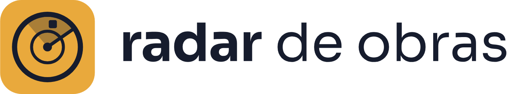

# Marca — radar de obras

**Ideia:** uma tela de radar varrendo a cidade, e um bloco (a obra) acabou de aparecer.
O nome diz o que o produto faz: encontrar obras antes da concorrência.

## Arquivos

| Arquivo | Uso |
|---|---|
| `icone.svg` / `icone.png` | Ícone do app, favicon, avatar (fundo ouro) |
| `icone-escuro.svg` | Ícone alternativo (fundo marinho, traço ouro) |
| `logo.svg` / `logo.png` | Logo horizontal para fundo claro |
| `logo-fundo-escuro.svg` / `.png` | Logo horizontal para fundo escuro |
| `logo-com-fundo.svg` | Logo com fundo branco (documentos, e-mail) |
| `gerar_marca.py` | Gera todos os SVGs (texto já convertido em curvas) |

## Cores

| Nome | Hex | Uso |
|---|---|---|
| Ouro | `#E9A93C` | Cor da marca: fundo do ícone, botão principal, aba ativa |
| Ouro suave | `#FDF3DF` | Fundo do filtro ou item selecionado |
| Ouro texto | `#8A5A00` | Links e texto do item selecionado (contraste AA sobre branco) |
| Marinho | `#161C2D` | Texto principal, traço do ícone, selo "PARÁ" |
| Fundo | `#F5F6F9` | Fundo das telas, atrás dos cartões |

O ouro puro (`#E9A93C`) não deve ser usado para texto sobre branco: o contraste é baixo.
No site aparece só o ícone; o nome "radar de obras" surge ao passar o mouse sobre ele.
O site tem só tema claro.

## Tipografia

- **Sora** (Google Fonts) — logo: "radar" em negrito (700) e "de obras" em regular (400), tudo minúsculo.
- **Inter** — textos do app.
